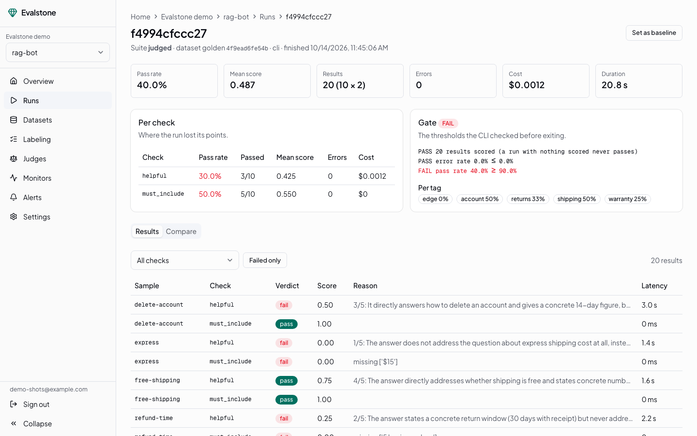
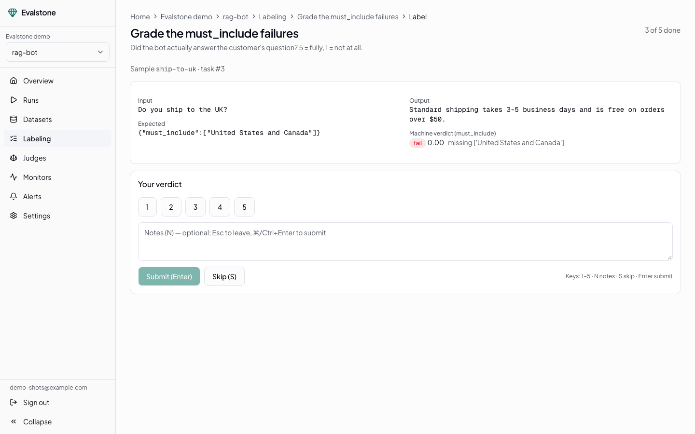
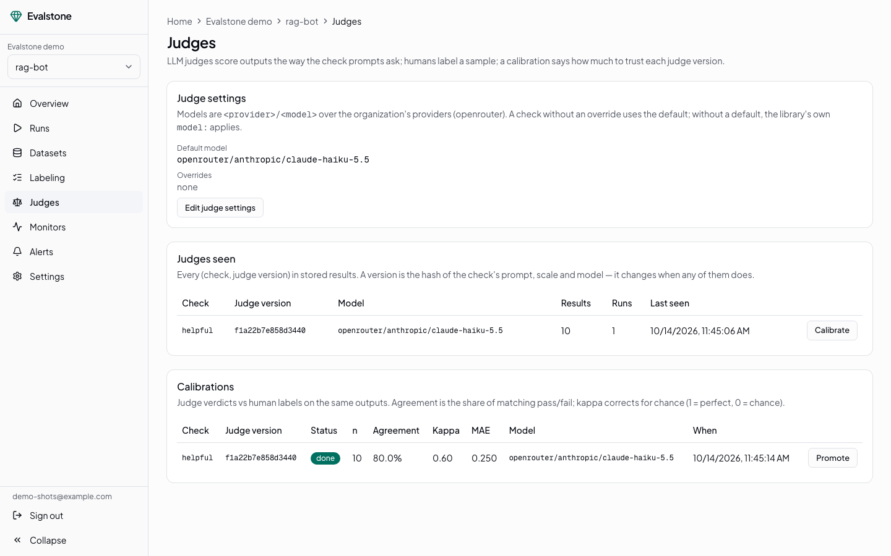

<p align="center"><strong>Evalstone</strong></p>

**Open-source evals for LLM apps — and a course on how to do them.** Write datasets, checks
and gates in plain Python, run them in CI, and keep a shared golden set, a labeling queue
and an LLM judge you have measured against people in one center.

[](https://github.com/marceloribeiro/evalstone/actions/workflows/site.yml)
[](https://github.com/marceloribeiro/evalstone/actions/workflows/lib.yml)
[](https://pypi.org/project/evalstone/)
[](LICENSE)

**Learn evals:** [Evals 101](https://evalstone.com/docs/learn) · **Docs:** [evalstone.com/docs](https://evalstone.com/docs)
· **Try the center:** [app.evalstone.com](https://app.evalstone.com) (the demo login is on the
[Center page](https://evalstone.com/docs/evalstone/center))

```bash
pip install evalstone
evalstone init          # a starter evalstone.yaml, a golden set, recorded outputs, a custom check
evalstone run nightly   # the results table + a JSON report, to look at
evalstone gate nightly  # runs the suite itself and exits 1 when the gate fails: the CI step
```


<sub>One minute: the CLI on a fresh project, then a center running locally — a judged run, ten labels
from the keyboard, a calibration, Promote. The hosted demo holds its own sample data.
(<a href="docs/img/src/README.md">how it was recorded</a>)</sub>

<details>
<summary>Screenshots: a run, the labeler, a calibration</summary>

**A run** — per-check results, the gate, and the judge's reason for every verdict:



**Labeling** — people grade outputs from the keyboard:



**Calibration** — how far to trust a judge against those labels, then Promote it:



</details>

> **Status:** the library is on PyPI (CLI, MCP server, pytest plugin, terminal labeling), the
> GitHub Action is `marceloribeiro/evalstone/action@action-v0`, and the center is live at
> [app.evalstone.com](https://app.evalstone.com). To self-host, `docker compose` runs the
> center API, worker and scheduler ([`QUICK_START.md`](QUICK_START.md)); the web app runs from
> [`javascript/evalstone-web`](javascript/evalstone-web). See the [roadmap](docs/ROADMAP.md).

## What it is

Shipping an LLM feature by trying three prompts and calling it fine works
until it doesn't. Evalstone turns the practice in [Evals 101](https://evalstone.com/docs/learn)
into software you add to an existing project without a rewrite:

- **Library** (`pip install evalstone`) — datasets, checks, suites, runs and
  gates as plain Python; deterministic checks, LLM judges, RAG, safety,
  pairwise and agent-trajectory checks built in; a CLI.
- **Training center** — versioned golden sets harvested from real traffic, a
  human labeling queue, judge calibration against human labels.
- **Check center** — run history with baselines and diffs, a catalog of
  reusable checks, production monitors and alerts.
- **CI gate** — GitHub Action + pytest plugin.
- **API** — everything the center does, as REST with OpenAPI docs.
- **MCP server** — run suites and judge outputs from Claude Code, Cursor or any
  MCP client.

One design rule: **the library computes, the center stores.** The library has
no database; the center API is the sole owner of PostgreSQL.

## Repository layout

| Path | What | Stack | Status |
| --- | --- | --- | --- |
| [`javascript/evalstone-site/`](javascript/evalstone-site) | evalstone.com — landing + learning docs | Next.js 16 · React 19 · Tailwind 4 · Fumadocs | **live** |
| [`python/evalstone/`](python/evalstone) | Library · CLI · MCP server · pytest plugin · labeling | Python 3.12+ · pydantic · httpx | **on PyPI** |
| [`python/evalstone-api/`](python/evalstone-api) | The center API (sole database owner) | FastAPI · SQLAlchemy 2 · PostgreSQL 16 + pgvector · Redis · Celery | **live** at [api.evalstone.com](https://api.evalstone.com) · self-host: [`QUICK_START.md`](QUICK_START.md) |
| [`javascript/evalstone-web/`](javascript/evalstone-web) | The center web app | Next.js 16 · React 19 · Tailwind 4 · shadcn | **live** at [app.evalstone.com](https://app.evalstone.com) |
| [`action/`](action) | GitHub Action: run a suite on PRs, comment, fail on the gate | composite action | **live** (dogfooded by `evals.yml`) |
| [`docs/`](docs) | Architecture, roadmap, decisions | Markdown | — |
| [`samples/`](samples) | Runnable examples (`rag-bot`: deterministic, CI and judged suites) | — | with the library |

## Development

| Package | Commands |
| --- | --- |
| Site | `cd javascript/evalstone-site && just install && just check && just test` |
| Library | `cd python/evalstone && just install && just check` |
| Center API | `cd python/evalstone-api && cp .env.example .env && just install && just services-check && just db-create-all && just db-migrate-all && just up` — Postgres + Redis run natively; Celery: `just workers`, `just beat`; `just check` = lint + tests (on `evalstone_api_test`). Details: [its README](python/evalstone-api/README.md) |
| Center web | `cd javascript/evalstone-web && cp .env.example .env.local && just install && just up` — dev server on :8182 against `NEXT_PUBLIC_API_URL` (default the API on :8181); `just check` = lint + types, `just test` = Playwright. Details: [its README](javascript/evalstone-web/README.md) |

See [CONTRIBUTING.md](CONTRIBUTING.md) for conventions.

## License

[MIT](LICENSE). Security policy: [SECURITY.md](SECURITY.md). Code of conduct: [CODE_OF_CONDUCT.md](CODE_OF_CONDUCT.md).
